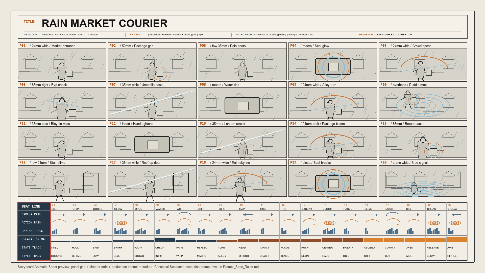
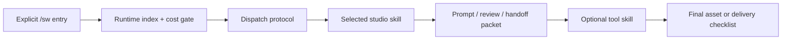

# SW Agents for Codex

[](https://github.com/BYBC1015/sw-agents-for-codex/actions/workflows/sw-ci.yml)

SW Agents for Codex is a local Codex skill framework for creative production work: briefs, posters, decks, storyboards, edit plans, AI image prompts, AI video prompts, review checklists, and tool handoffs.

It is built for daily creative work where the hard part is not only generating an asset, but keeping the idea, references, constraints, revision history, and final handoff stable.

Current runtime: `V1.16.0`

Stable entry: `/sw`, `/SW_V1.0`, or `@SW_V1.0`

Install guide: [INSTALL_SW.md](INSTALL_SW.md)

## What It Does

- Turns rough creative requirements into a controlled production flow.
- Routes work to small local studio roles such as brief, storyboard, prompt, layout, review, and finishing.
- Keeps SW opt-in: ordinary design words do not trigger the full studio framework.
- Supports explicit tool skills for Banana Pro, Dreamina CLI, Kling CLI/MCP, Kling API (3.0 / 3.0 Omni), Seedance 2.0, URL Relay, Feishu Docs, storyboard DOCX handoff, and local cutout work.
- Connects an existing local Hermes installation to the live project and shared Kling runner through `hermes-bridge`, using file handoffs without copying keys or starting background model sessions.
- Adds cost gates before expensive image/video generation or external upload steps.
- Preserves project state through lightweight structures such as Project Asset Graph, Selected Asset Packet, Change Delta Packet, Review Delta Packet, and Storyboard Animatic Sheet.

## SW Canvas

The local canvas is now included in [apps/media-canvas](apps/media-canvas/README.md). It stores versioned shots and shared assets, shows which shots need review after changes, and exports selected storyboard manifests. Install its Python dependencies before launching. Project databases, client media and credentials are never part of the source release.

## Showcase

### Storyboard Animatic Sheet

SW can create a high-information storyboard sheet for AI video execution. The sheet is not just a moodboard. It includes panel order, camera path, action path, rhythm, escalation, state, and style tracks so a downstream video prompt can reference the storyboard, character, environment, and panel beats without drifting.



More examples and prompt contracts: [docs/SHOWCASE.md](docs/SHOWCASE.md)

## Quick Start

Clone the repository, then run the bootstrap from the repo root:

```powershell
python .\tools\sw_bootstrap.py
```

If Windows uses the Python launcher:

```powershell
py -3 .\tools\sw_bootstrap.py
```

The bootstrap copies the SW skills and plugin entries into the local Codex folders, runs health checks, and reports which optional tools still need private local configuration.

Then open Codex and start SW explicitly:

```text
/sw
```

Expected reply:

```text
SW loaded successfully. Current version: V1.16.0
```

## Core Commands

| Command | Purpose |
| --- | --- |
| `/sw`, `/SW_V1.0`, `@SW_V1.0` | Start the SW studio framework explicitly. |
| `@sw_update` | Synchronize an active conversation with the current runtime version. |
| `/sw-rescue`, `@sw_rescue` | Recover from stale old skill chips or stale conversation snapshots. |
| `@sw_help` | Show compact feature triggers without loading the full framework. |
| `@banana-pro` | Run explicit Banana Pro / OpenRouter image generation after prompt prep. |
| `@dreamina-cli` | Use the official Dreamina/Jimeng CLI route after prompt prep and CLI help inspection. |
| `@kling-cli` | Use the official Kling CLI/MCP route after prompt prep and live model/tool inspection. |
| `@seedance-2-video` | Run explicit Seedance 2.0 video generation after storyboard/prompt prep. |
| `@url-relay` | Upload local media to a configured public URL relay for downstream tools. |
| `@storyboard-visual-word` | Build a DOCX visual director handoff from selected images. |
| `@feishu-docs` | Render or publish visual handoff content to Feishu/Lark Docs. |

## Architecture



Default fast path:

```text
SW_Runtime_Index.md
  -> Cost_Governor.md
  -> Studio_Skill_Dispatch_Protocol.md
  -> Studio_Skills/<selected-skill>/SKILL.md
```

Full architecture details:

- [PULL_ARCHITECTURE.md](PULL_ARCHITECTURE.md)
- [Stage_Runbook.md](Stage_Runbook.md)
- [Production_Pipeline_Map.md](Production_Pipeline_Map.md)
- [Auto_Assignment_Rules.md](Auto_Assignment_Rules.md)
- [docs/REPOSITORY_MAP.md](docs/REPOSITORY_MAP.md)

## Repository Map

| Path | Purpose |
| --- | --- |
| [AGENTS.md](AGENTS.md) | Root Codex rules and explicit SW activation gate. |
| [SW_Runtime_Index.md](SW_Runtime_Index.md) | Compact runtime index used on most turns. |
| [Studio_Skills/](Studio_Skills/) | Local role skills for brief, direction, storyboard, prompt, review, and delivery work. |
| [Prompts/](Prompts/) | Prompt standards and tool-specific prompt deltas. |
| [banana-pro/](banana-pro/) | Explicit Banana Pro / OpenRouter image generation skill. |
| [dreamina-cli/](dreamina-cli/) | Explicit official Dreamina/Jimeng CLI image and video generation skill. |
| [kling-cli/](kling-cli/) | Explicit official Kling CLI/MCP image and video generation skill. |
| [seedance-2-video/](seedance-2-video/) | Explicit Seedance 2.0 video generation skill. |
| [url-relay/](url-relay/) | Public URL relay tool for local media handoff. |
| [tools/](tools/) | Bootstrap, doctor, sync, and consistency scripts. |
| [docs/](docs/) | Handoffs, showcase material, and repo-level documentation. |

## Safety Model

- SW is explicit-only. The full framework starts only when the user asks for `/sw`, `/SW_V1.0`, `@SW_V1.0`, or another documented SW entry.
- API keys are local-private. The repo stores setup scripts and dry-run payload logic, not real secrets.
- Expensive or external actions are gated. Image/video generation, upload, publishing, and irreversible actions require an explicit user request.
- Tool prompts keep a canonical source where possible to reduce version drift.

## Maintenance Checks

Run the repository consistency check:

```powershell
python .\tools\sw_consistency_check.py --scope repo
```

Run the broader local doctor:

```powershell
python .\tools\sw_doctor.py --scope all
```

Synchronize installed local skills/plugin from the repo:

```powershell
python .\tools\sw_sync_installed.py
```

## Version History

The README shows only the current public entry points. Detailed release history lives in:

- [VERSION.md](VERSION.md)
- [Architecture_Update_Log.md](Architecture_Update_Log.md)

Latest highlighted runtime changes:

- `V1.16.0`: Adds [SW Canvas 0.4.0](apps/media-canvas/README.md), persistent shot versions, dependency impact checks, protected prompt locks, and explicit visual review before final manifest export.
- `V1.15.0`: Updated Kling API Key support to current Kling 3.0 generation and 3.0 Omni video reference/edit endpoints; retained explicit legacy compatibility and added the local Hermes collaboration bridge.
- `V1.14.0`: Added the explicit Kling official CLI/MCP route as `kling-cli`, separate from the existing AK/SK `kling-api` route, with OAuth/login, live model inspection, generation, upload, batch, and polling guardrails.
- `V1.13.1`: Fixed Banana Pro key replacement precedence so the local private `openrouter.env` key wins over stale process environment values.
- `V1.13.0`: Added the explicit Dreamina/Jimeng official CLI route as `dreamina-cli`, separate from the Ark Seedance API route, with install/login/generation/upload/batch/async guardrails.
- `V1.12.17`: Added Project Asset Graph before storyboard so video/film/storyboard routes ask or assume existing assets, assets to create, and continuity locks before shot tables or AI-video prompts.
- `V1.12.16`: Rebuilt the GitHub landing page, added a storyboard showcase, repository map, contribution/security docs, issue/PR templates, and tighter ignore rules. Runtime behavior is unchanged.
- `V1.12.15`: Repaired stale architecture pull instructions and reduced Seedance storyboard prompt duplication by making `Prompts/Prompt_Spec_Rules.md` the canonical full template.
