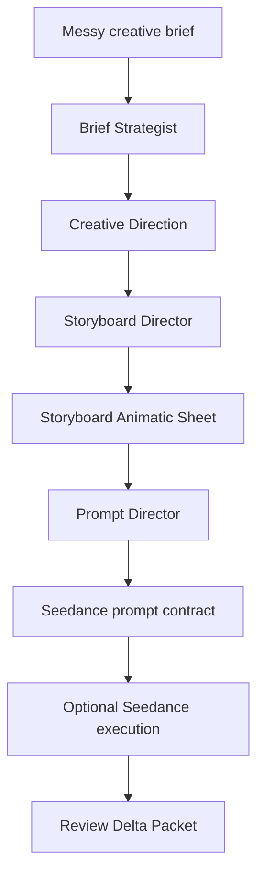

# SW Showcase

This page collects compact examples that explain what SW does before a user runs the full framework.

## 1. Storyboard Animatic Sheet

The Storyboard Animatic Sheet is a high-information planning artifact for AI video execution. It is designed to be generated with GPT Image 2 / the default image skill, then passed into a video prompt workflow such as Seedance/Jimeng.


What makes it different from a normal storyboard:

- `panel grid`: ordered frame sequence with panel IDs, lens notes, shot type, and beat title
- `director strip`: the bottom control band that maps the whole sequence across time
- `Beat Line`: the semantic beat for every panel
- `Camera Path`: arrows or curves describing camera movement
- `Action Path`: body/object motion path
- `Rhythm Track`: visual density and cut rhythm
- `Escalation Map`: intensity curve across the sequence
- `State Track`: narrative state such as still, ignition, build, impact, or resolve
- `Style Track`: per-beat style/emotion tags that keep the whole sequence coherent

The key rule: a plain storyboard image without the director strip is only a visual reference. It cannot be treated as a strict video execution blueprint.

## 2. Storyboard To Seedance Prompt Contract

The canonical full template is stored in:

```text
Prompts/Prompt_Spec_Rules.md
```

Other files should reference that section rather than copying the full prompt. This prevents drift between `Prompt_Spec_Rules.md`, `Video_Motion_Edit_Prompt_Rules.md`, and `seedance-2-video/SKILL.md`.

Compact structure:

```text
Use @[storyboard ref] as the locked motion and sequence source.
Use @[character ref] as the locked character identity source.
Use @[environment ref] as the locked environment and spatial source.

Create one continuous video sequence that follows the storyboard panel order.

PANEL BEATS:
P01 ...
P02 ...
...

LOCK:
- character identity
- environment continuity
- panel order
- camera/action/rhythm/state/style tracks

AVOID:
- changing the character
- inventing new locations
- skipping panel beats
- turning the board into a different story
```

## 3. Explicit Tool Skills

SW separates creative planning from tool execution.

| Tool skill | What it does | Trigger |
| --- | --- | --- |
| Banana Pro | Image generation through OpenRouter after prompt prep. | `@banana-pro`, `banana`, `Banana Pro`, `Nano Banana` |
| Seedance 2.0 | Video generation through Volcano Ark / Jimeng-compatible flow. | `@seedance-2-video`, `Seedance 2.0`, `即梦生成` |
| URL Relay | Converts local media into public URLs for downstream tools. | `@url-relay`, `公网URL`, `URL中转` |
| Storyboard Visual Word | Builds DOCX visual handoff files from selected images. | `@storyboard-visual-word`, `Word视觉方案` |
| Feishu Docs | Renders or publishes visual handoff docs to Feishu/Lark. | `@feishu-docs`, `飞书`, `Lark Docs` |

These tools are explicit-only. Ordinary poster, deck, storyboard, or video wording does not run them automatically.

## 4. Example Project Flow



The framework is intentionally conservative: it does low-cost routing first, then asks for confirmation before expensive generation, upload, or publishing.
